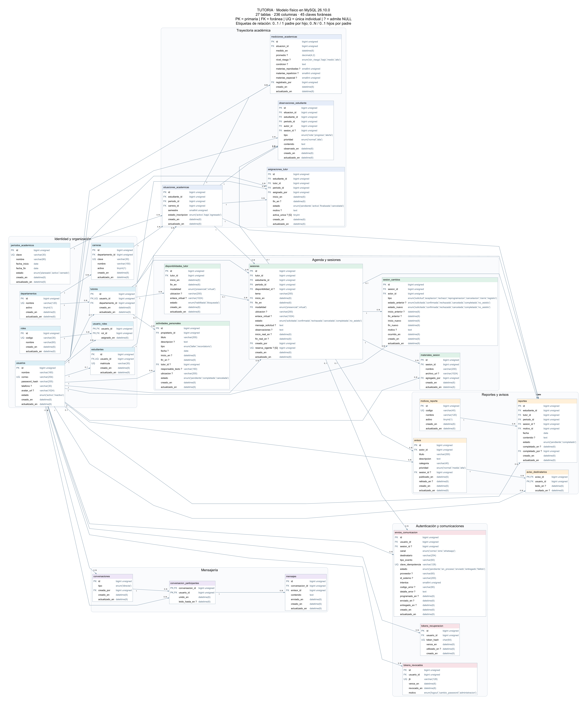

# Sistema de tutorías

Proyecto con frontend React/Vite, backend Spring Boot (Java) y MySQL. Las pantallas continúan como mockup y el backend está en preparación: aún no hay autenticación, API ni envío real de comunicaciones.

## Conexión del backend con MySQL

El backend ya puede conectarse a `tutoria`. Usa las variables `BD_SERVIDOR`, `BD_PUERTO`, `BD_NOMBRE`, `BD_USUARIO` y `BD_CONTRASENA`, definidas en `backend/.env` o en el entorno del proceso. El archivo `.env` se lee como propiedades de Java: escribe los valores sin comillas ni `export`. Para una contraseña con barras invertidas, escribe cada barra dos veces.

`backend/.env.example` sirve como plantilla sin secretos; `application.properties.example` muestra la configuración compartida. El `.env` real está excluido por el `.gitignore` general.

Desde `backend`, ejecutar `./mvnw.cmd spring-boot:run` en Windows (o `./mvnw spring-boot:run` en Linux). La prueba de arranque se ejecuta con `./mvnw.cmd test`. Hibernate no crea ni cambia tablas. Flyway revisa las migraciones al arrancar y aplica solamente las que faltan, antes de iniciar JPA.

## Respuestas de error del backend

El paquete `errores` contiene `RespuestaError` y `ManejadorErrores`. Por ahora cubre validación de formularios con `@Valid` y JSON que no se puede leer. No se agregaron endpoints de negocio.

Cuando los campos no cumplen sus reglas, la respuesta es HTTP 422:

```json
{
  "estado": 422,
  "mensaje": "Revisa los campos del formulario.",
  "erroresPorCampo": {
    "correo": ["Escribe un correo válido."]
  }
}
```

Cada campo puede tener varios mensajes. Los errores del formulario completo se agrupan en `general`. Un cuerpo vacío, JSON mal escrito o un tipo incorrecto devuelve HTTP 400 con un mensaje general y `erroresPorCampo` vacío. No se devuelve el contenido rechazado ni detalles de la excepción.

Las reglas se escriben en los futuros DTOs mediante Bean Validation; el manejador solo organiza sus mensajes. Los errores de recursos inexistentes, seguridad y otros módulos se agregarán en sus respectivos avances.

Las seis pruebas de este manejador usan un controlador que existe solamente en los archivos de prueba, sin necesitar MySQL. La prueba general de arranque continúa utilizando la configuración local de la base. Ejecutar todo con `./mvnw.cmd test` desde `backend`; Maven reconoce también los archivos terminados en `Pruebas` para conservar los nombres en español. El avance inicial pasó sus siete pruebas.

## Entidades de usuarios y roles

El paquete `entidades` contiene `Usuario` y `Rol`, que representan las tablas existentes `usuarios` y `roles`. La relación muchos a muchos utiliza `usuario_roles`; su fecha `asignado_en` sigue siendo completada por MySQL. No se modificó el esquema ni el diagrama ER.

Los atributos y métodos propios están en español. `contrasenaHash` corresponde a la columna existente `password_hash`; esta clase recibe un hash ya generado, no cifra contraseñas por sí sola. El usuario permite actualizar sus datos, activar/desactivar su estado y asignar o quitar roles. Las fechas se leen desde MySQL después de recargar la entidad.

Los roles se cargan cuando se consultan (LAZY), sin guardar ni borrar automáticamente los roles compartidos al cambiar un usuario. Las entidades no implementan servicios, endpoints ni autenticación, y no se devuelven al frontend. Las consultas están en los repositorios descritos abajo.

Se añadieron tres pruebas sobre MySQL: lectura del catálogo de roles, guardado/lectura de un usuario con varios roles y eliminación de vínculos sin borrar roles compartidos. Estas pruebas usan `ddl-auto=validate` para comprobar las tablas sin cambiarlas y revierten sus datos al terminar. El avance de entidades pasó sus diez pruebas.

## Repositorios de usuarios y roles

El paquete `repositorios` contiene `RepositorioUsuarios` y `RepositorioRoles`. Son las clases de acceso a datos que podrán usar los futuros servicios; no agregan rutas HTTP ni inicio de sesión.

- `buscarPorCorreo` busca un usuario y mantiene sus roles sin cargar hasta que se necesiten.
- `buscarPorCorreoConRoles` obtiene al usuario y sus roles juntos. También devuelve al usuario si aún no tiene roles.
- `buscarPorCodigo` busca un rol por su código, por ejemplo `coordinador`, no por su nombre visible.

Las búsquedas devuelven `Optional`: si no hay coincidencia, el resultado está vacío. Los valores recibidos se pasan como parámetros de la consulta. Los métodos propios están en español; se conservan los nombres de las clases, anotaciones y operaciones heredadas de Spring Data.

Se agregaron seis pruebas sobre MySQL para comprobar búsquedas, resultados vacíos, carga de roles y entradas con comillas. Los registros de esas pruebas se revierten al terminar. Pasaron las dieciséis pruebas actuales del backend. No se modificó el esquema ni el ER.

## Base de datos

`tutoria` está en MySQL Community Server 26.10.0 con **27 tablas funcionales, 236 columnas, 45 claves foráneas, 37 CHECK y 4 vistas**. Existe además la tabla técnica `flyway_schema_history` (28 tablas físicas en total).

Las 24 tablas originales se adoptaron como baseline V1 tras comparar columnas y claves con la estructura existente. Flyway aplicó V2 sin eliminar cuentas ni datos:

- `tokens_recuperacion`: digest SHA-256 del token, usuario, vencimiento y uso. El token original no se almacena.
- `tokens_revocados`: identificador JWT `jti`, usuario, vencimiento y motivo de revocación. No almacena el JWT completo.
- `envios_comunicacion`: correo/SMS/WhatsApp, destinatario, evento, idempotencia, proveedor, intentos, estado y errores.

Crear estas tablas no implementa login, recuperación, logout ni comunicaciones: esas operaciones serán responsabilidad del futuro backend.

## Migraciones e instalación

Las migraciones oficiales están en `backend/src/main/resources/base_datos/migraciones`. No editar una migración ya aplicada; crear V3, V4, etc. El POM de `database` permite trabajar con Flyway sin arrancar Spring Boot.

Requisitos: Java, Maven Wrapper del backend, Node.js, MySQL y una base vacía creada con utf8mb4/utf8mb4_0900_ai_ci. Las migraciones crean las tablas, no el servidor ni las credenciales.

Desde la raíz:

```powershell
npm install --prefix frontend/.mysql-tools --no-save --package-lock=false mysql2 @viz-js/viz @resvg/resvg-js
# Crear frontend/database/connection.local.json según connection.example.json.
node database/flyway.cjs migrate
node database/flyway.cjs validate
# Solo para desarrollo/demostración:
node database/seed.cjs
```

`migrate` en una base vacía ejecuta V1 y V2. La base local existente ya está en V2: no ejecutar baseline nuevamente. Para adoptar otra base preexistente, comparar su estructura con V1 y respaldarla antes de usar baseline; el baseline automático está deshabilitado. `clean` está deshabilitado.

La herramienta lee las credenciales del archivo local excluido por Git y las entrega a Flyway mediante variables de entorno. No las imprime ni las incorpora al POM. `FLYWAY_URL` permite elegir otra conexión JDBC; `FLYWAY_OFFLINE=true` permite usar las dependencias ya descargadas. El backend utiliza la misma versión de Flyway (13.12.1) y ejecuta automáticamente las migraciones al arrancar. Las herramientas de `database` siguen disponibles para mantenimiento.

## Preparar la base en otra computadora

No hace falta copiar la base de datos de otro integrante ni compartir su contraseña. Cada persona usa su propio MySQL y sus credenciales locales.

Crear solamente la base vacía desde MySQL Workbench o un cliente MySQL:

```sql
CREATE DATABASE tutoria
  CHARACTER SET utf8mb4
  COLLATE utf8mb4_0900_ai_ci;
```

Desde la carpeta `backend`, copiar la plantilla y completar los datos de esa computadora:

```powershell
Copy-Item .env.example .env
# Editar .env con el usuario y la contraseña propios.
.\mvnw.cmd spring-boot:run
```

Al arrancar, Flyway ejecuta V1 y V2 sobre esa base vacía. Quedan creadas las 27 tablas funcionales, las 4 vistas, los catálogos iniciales y su tabla de historial. Volver a arrancar no repite las migraciones aplicadas. Hibernate conserva `ddl-auto=none`. Se comprobaron ambos arranques con una base temporal vacía y se confirmó que la base principal conserva sus datos.

Los usuarios y ejemplos se cargan aparte: abrir `database/seeds/001_datos_demo.sql` en MySQL Workbench, seleccionar `tutoria` como base de trabajo y ejecutar el script. También se puede usar `node database/seed.cjs` con la configuración local de las herramientas. El seed crea las cuentas documentadas abajo y se puede repetir sin duplicarlas. El arranque del backend no carga estos datos automáticamente.

Si ya existe una base con tablas, no importar el esquema antiguo ni activar baseline automático para saltarse errores. La base local original ya tiene su baseline registrado; una base nueva vacía no necesita ese paso. Las migraciones que ya estén aplicadas se conservan sin editar.

## Datos de demostración y acceso futuro

El seed explícito `database/seeds/001_datos_demo.sql` conserva las cuentas existentes y se puede repetir sin duplicar los ejemplos. Se verificó también desde una base vacía.

| Rol | Correo | Contraseña de demostración |
|---|---|---|
| Coordinación / administrador | coordinacion@demo.example | CoordDemo!2026 |
| Tutor | tutor@demo.example | TutorDemo!2026 |
| Estudiante | estudiante@demo.example | AlumnoDemo!2026 |

Hay 31 cuentas (1 coordinación, 15 tutores y 15 estudiantes), 15 sesiones, 15 reportes, 15 avisos, 15 conversaciones y 30 mensajes. Los perfiles adicionales usan tutor02..tutor15@demo.example y estudiante02..estudiante15@demo.example, con la misma contraseña de demostración de su rol. Todas las contraseñas están hasheadas con BCrypt.

Los registros de comunicaciones son ficticios, están marcados como fallidos con `DEMO_NO_ENVIAR` y no representan entregas reales. No se generaron tokens de recuperación ni JWT activos. Los catálogos y tablas técnicas no necesitan 15 filas: roles tiene 3 y motivos tiene 4. El detalle por tabla está en `database/verificacion-v2.json`.

Estas cuentas todavía no permiten iniciar sesión en la aplicación: el frontend permanece desconectado.

## Diagrama entidad-relación actualizado

El diagrama procede de los metadatos del MySQL real; incluye las tres tablas nuevas, FK compuestas y columnas generadas. El historial técnico de Flyway se excluye del dominio.



- [SVG ampliable](frontend/database/diagrama-er/tutoria-er.svg)
- [Mermaid editable](frontend/database/diagrama-er/tutoria-er.mmd)
- [Diccionario, índices y restricciones](frontend/database/diagrama-er/DIAGRAMA_ER.md)
- [Respaldo SQL de estructura V2 sin datos sensibles](database/respaldo_estructura_v2.sql)

## Verificación realizada

```powershell
node frontend/database/manage.cjs --check
node frontend/database/manage.cjs --test
node database/verificar-v2.cjs
node database/verificar-migraciones.cjs
node database/exportar-er.cjs
```

Pasaron 21 pruebas de integridad (12 originales y 9 de V2). Sus registros temporales se revierten. También se ejecutaron V1 y V2 en una base temporal vacía, se repitió el seed y se verificaron los conteos; esa base temporal se eliminó al terminar. La base principal conserva sus datos.

Flyway informa que MySQL 26.10 es más reciente que su última versión verificada. Las migraciones y comprobaciones de este proyecto sí se ejecutaron correctamente sobre este servidor; conservar estas pruebas al actualizar dependencias.

El respaldo local anterior a la migración está en `database/backups`, excluido de Git. El archivo `frontend/database/001_tutoria.sql` se conserva como referencia histórica V1; no debe usarse para nuevas instalaciones. El comando antiguo `manage.cjs --create` está deshabilitado.

Referencia: [baseline de Flyway](https://github.com/flyway/flyway/blob/main/documentation/Reference/Commands/Baseline.md).
