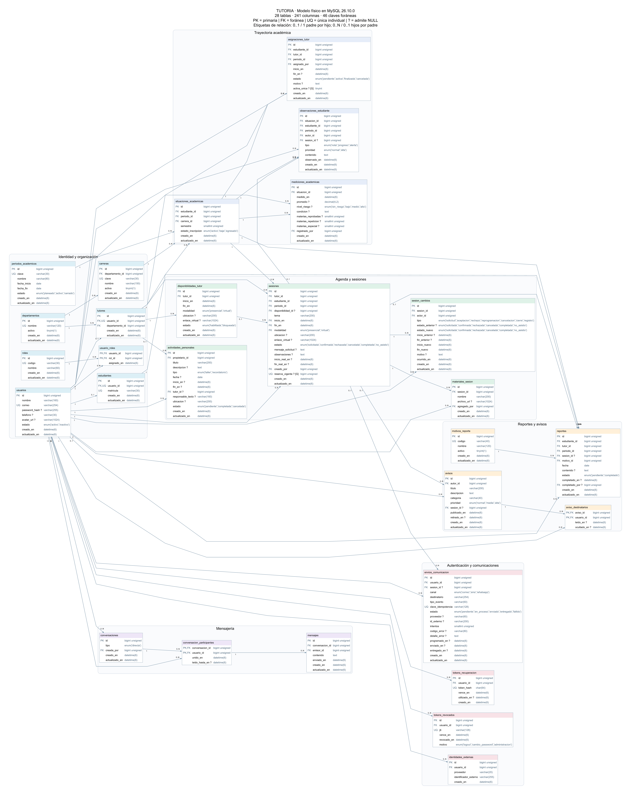

# Sistema de tutorías

Proyecto con frontend React/Vite, backend Spring Boot (Java) y MySQL. El inicio de sesión por correo y contraseña ya conecta React con Spring Boot y MySQL mediante JWT. El resto de los módulos conserva por ahora sus datos de demostración; no hay envío real de comunicaciones.

## Inicio de sesión conectado

El formulario de React está conectado al backend. El registro crea cuentas de estudiante y abre su sesión. El acceso con Google ya funciona en el entorno local configurado. En nuevas instalaciones se activa al configurar el ID de cliente y autorizar los orígenes en Google Cloud. La recuperación de contraseña sigue pendiente.

### Configuración y arranque

En `backend/.env` se mantienen las variables de MySQL y se agregan:

- `JWT_CLAVE`: clave aleatoria en Base64 con al menos 32 bytes. No compartirla con el frontend ni subirla a Git. Cada instalación usa la suya.
- `JWT_MINUTOS_VIGENCIA`: 15 por defecto; admite entre 1 y 1440 minutos.
- `ORIGENES_PERMITIDOS`: por defecto `http://localhost:5173,http://127.0.0.1:5173`.

Para generar una clave en otra computadora:

```powershell
node -e "console.log(require('node:crypto').randomBytes(32).toString('base64'))"
```

Copiar el resultado solo al valor `JWT_CLAVE` del `.env` local. La clave de esta instalación ya fue generada sin mostrarla. `application.properties` contiene referencias a las variables, no valores secretos.

Levantar el backend desde `backend`:

```powershell
.\mvnw.cmd spring-boot:run
```

Levantar React desde `frontend`, en otra terminal:

```powershell
npm install
Copy-Item .env.example .env
npm run dev
```

No reemplazar un `.env` local ya configurado. `VITE_URL_API=/api` utiliza el proxy de Vite hacia `http://127.0.0.1:8080`. En producción, el servidor web deberá redirigir `/api` al backend o habrá que ajustar la URL pública y los orígenes permitidos. Ninguna clave privada pertenece a una variable `VITE_`.

### API de autenticación

| Método | Ruta | Acceso | Resultado |
|---|---|---|---|
| POST | `/api/autenticacion/iniciar-sesion` | Público | JWT, vencimiento y perfil básico |
| POST | `/api/autenticacion/registrar` | Público | Crea estudiante, devuelve JWT y perfil (201) |
| POST | `/api/autenticacion/google` | Público | Verifica Google, vincula o crea cuenta y devuelve JWT |
| GET | `/api/autenticacion/sesion` | `Authorization: Bearer <token>` | Perfil de la cuenta actual, comprobado en MySQL |

Cuerpo del login, usando una cuenta del seed:

```json
{"correo":"estudiante@demo.example","contrasena":"AlumnoDemo!2026"}
```

La validación exige un correo válido y contraseña con mínimo 8 caracteres, una mayúscula, un número y un carácter especial. Se respeta el límite de BCrypt; React también señala contraseñas demasiado largas. El backend compara el hash, revisa que la cuenta esté activa y tenga roles, y devuelve un DTO sin contraseña ni hash. Un correo inexistente y una contraseña incorrecta generan el mismo mensaje.

El JWT se firma con HS256 e incluye identificador de usuario, roles, emisor, audiencia, identificador único, emisión y vencimiento. Spring Security comprueba firma, emisor, audiencia y caducidad. Las rutas de coordinación se reservan a coordinación; las de tutor y estudiante permiten su rol y coordinación. Actualmente esos módulos aún no tienen endpoints de negocio. La consulta de sesión además comprueba el estado actual del usuario en MySQL.

React abre la pantalla de coordinación, tutor o estudiante según los roles devueltos por el servidor; si hay varios, prioriza coordinación y después tutor. Muestra el nombre y correo auténticos, bloquea el botón durante la solicitud y presenta errores debajo de los campos o un mensaje general ante fallos de acceso/red. Las peticiones protegidas usan `Authorization`.

Sin marcar recordar se usa `sessionStorage`; al marcarlo se usa `localStorage`. Solo se guardan token y vencimiento, nunca la contraseña ni roles usados como fuente de permisos. Al recargar se verifica la sesión con el servidor antes de mostrar las pantallas. Recordar no amplía la duración del JWT. Al vencer, se vuelve al login.

**Alcance de Salir:** por ahora elimina la sesión del navegador. El JWT emitido sigue siendo válido hasta vencer; la invalidación en el servidor mediante `tokens_revocados` corresponde al siguiente avance de logout. No se presenta esa función como ya implementada.

### Registro de cuentas

Las indicaciones del proyecto piden registro, validación en frontend/backend y contraseñas protegidas con BCrypt. Google es una función adicional solicitada para este avance.

El enlace **Regístrate** solicita nombre, matrícula, correo, contraseña y confirmación. El servidor siempre asigna `estudiante`; enviar otros roles no concede permisos. Correo y matrícula deben ser únicos. Usuario, rol y perfil se guardan juntos: si algo falla, no queda una cuenta a medias. Tras registrarse, se abre la sesión sin marcar recordar.

```json
{"nombre":"Estudiante nuevo","matricula":"ALUMNO-100","correo":"nuevo@example.com","contrasena":"MiClave!123","confirmarContrasena":"MiClave!123"}
```

### Acceso con Google

La integración usa Google Identity Services y un ID de cliente OAuth de tipo **Aplicación web**. No necesita secreto de cliente para este flujo. Crear el cliente siguiendo la [guía oficial de Google](https://developers.google.com/identity/gsi/web/guides/get-google-api-clientid) y autorizar como orígenes JavaScript `http://localhost:5173` y `http://127.0.0.1:5173`. Para despliegue, agregar el origen HTTPS real.

Colocar el mismo ID público en ambas variables y reiniciar los dos proyectos:

```dotenv
# backend/.env
GOOGLE_CLIENTE_ID=
# frontend/.env
VITE_GOOGLE_CLIENTE_ID=
```

Al estar vacías, el frontend muestra Google desactivado y la API devuelve 503 si se intenta utilizarlo. No se colocaron credenciales inventadas. Cuando se configuren, aparecerá el botón oficial de Google.

El frontend manda `credencial` y `comprobacion` a `/api/autenticacion/google`. El backend verifica la firma RS256 con las claves públicas de Google, emisor, audiencia, vencimiento, correo verificado y la comprobación del acceso. Guarda el identificador estable de Google (`sub`), no su token.

- Cuenta nueva: el formulario pide matrícula y crea un estudiante. La contraseña local queda en NULL; esa cuenta ingresa con Google.
- Correo ya registrado: pide la contraseña actual del sistema antes de vincular. Conserva sus roles. Las siguientes entradas usan la identidad vinculada.
- Cuenta inactiva: el acceso se rechaza aunque Google sea válido.

Las pruebas verifican firmas RSA y los casos de creación/vinculación con datos controlados. El usuario confirmó el acceso correcto con una cuenta real de Google en el entorno local.

V3 agrega `identidades_externas` y permite `usuarios.password_hash` nulo para cuentas exclusivas de Google. No altera las contraseñas existentes. El diagrama ER y sus metadatos se regeneraron desde el motor.

### Pruebas de este avance

- 52 pruebas del backend: autenticación, JWT, roles, validación, registro, vinculación y verificación criptográfica de Google. Los datos temporales se revierten.
- 6 peticiones y pruebas Bruno ejecutadas contra la API real: login, sesión con JWT, contraseña incorrecta, campos inválidos, falta de token y acceso de rol no permitido.
- 10 comprobaciones adicionales de registro real en navegador: campos, confirmación, duplicados, creación de estudiante, restauración de sesión y móvil. La cuenta de prueba se eliminó al terminar.
- 25 comprobaciones de navegador del login: acceso real de los tres perfiles, errores, carga, recarga, almacenamiento según recordar, salida local, token alterado y móvil sin desbordamiento.

La colección versionada está en `bruno`. Abrir esa carpeta en Bruno y ejecutar las peticiones en su orden; el token se conserva solo como variable de ejecución. La ruta de coordinación utilizada en la prueba de 403 no es un endpoint de negocio: comprueba que el filtro bloquee al estudiante antes de buscar un controlador.

También se puede ejecutar la colección desde esa carpeta con `npx --package @usebruno/cli bru run`. No guardar tokens reales en los archivos versionados. Las pruebas Java se ejecutan con `./mvnw.cmd test` desde `backend`.

## Conexión del backend con MySQL

El backend ya puede conectarse a `tutoria`. Usa las variables `BD_SERVIDOR`, `BD_PUERTO`, `BD_NOMBRE`, `BD_USUARIO` y `BD_CONTRASENA`, definidas en `backend/.env` o en el entorno del proceso. El archivo `.env` se lee como propiedades de Java: escribe los valores sin comillas ni `export`. Para una contraseña con barras invertidas, escribe cada barra dos veces.

`backend/.env.example` sirve como plantilla sin secretos; `application.properties.example` muestra la configuración compartida. El `.env` real está excluido por el `.gitignore` general.

Desde `backend`, ejecutar `./mvnw.cmd spring-boot:run` en Windows (o `./mvnw spring-boot:run` en Linux). La prueba de arranque se ejecuta con `./mvnw.cmd test`. Hibernate no crea ni cambia tablas. Flyway revisa las migraciones al arrancar y aplica solamente las que faltan, antes de iniciar JPA.

## Respuestas de error del backend

El paquete `errores` contiene `RespuestaError` y `ManejadorErrores`. Cubre validación de formularios con `@Valid`, JSON que no se puede leer y errores de acceso. Los errores de los filtros de Spring Security usan el mismo formato JSON.

Cuando los campos no cumplen sus reglas, la respuesta es HTTP 422:

```json
{
  "estado": 422,
  "mensaje": "Revisa los campos del formulario.",
  "erroresPorCampo": {
    "correo": ["Escribe un correo válido."]
  }
}
```

Cada campo puede tener varios mensajes. Los errores del formulario completo se agrupan en `general`. Un cuerpo vacío, JSON mal escrito o un tipo incorrecto devuelve HTTP 400 con un mensaje general y `erroresPorCampo` vacío. No se devuelve el contenido rechazado ni detalles de la excepción.

Las reglas se escriben en los DTOs mediante Bean Validation; el manejador organiza sus mensajes. El login devuelve 401 para credenciales incorrectas y 403 para cuentas inactivas o sin rol. Los errores de recursos inexistentes y otros módulos se agregarán en sus respectivos avances.

Las seis pruebas de este manejador usan un controlador que existe solamente en los archivos de prueba, sin necesitar MySQL. La prueba general de arranque continúa utilizando la configuración local de la base. Ejecutar todo con `./mvnw.cmd test` desde `backend`; Maven reconoce también los archivos terminados en `Pruebas` para conservar los nombres en español. El avance inicial pasó sus siete pruebas.

## Entidades de usuarios y roles

El paquete `entidades` contiene `Usuario` y `Rol`, que representan las tablas existentes `usuarios` y `roles`. La relación muchos a muchos utiliza `usuario_roles`; su fecha `asignado_en` sigue siendo completada por MySQL. No se modificó el esquema ni el diagrama ER.

Los atributos y métodos propios están en español. `contrasenaHash` corresponde a la columna existente `password_hash`; esta clase recibe un hash ya generado, no cifra contraseñas por sí sola. El usuario permite actualizar sus datos, activar/desactivar su estado y asignar o quitar roles. Las fechas se leen desde MySQL después de recargar la entidad.

Los roles se cargan cuando se consultan (LAZY), sin guardar ni borrar automáticamente los roles compartidos al cambiar un usuario. Las entidades no implementan servicios, endpoints ni autenticación, y no se devuelven al frontend. Las consultas están en los repositorios descritos abajo.

Se añadieron tres pruebas sobre MySQL: lectura del catálogo de roles, guardado/lectura de un usuario con varios roles y eliminación de vínculos sin borrar roles compartidos. Estas pruebas usan `ddl-auto=validate` para comprobar las tablas sin cambiarlas y revierten sus datos al terminar. El avance de entidades pasó sus diez pruebas.

## Repositorios de usuarios y roles

El paquete `repositorios` contiene `RepositorioUsuarios` y `RepositorioRoles`. Son las clases de acceso a datos utilizadas por el servicio de autenticación; no exponen rutas HTTP directamente.

- `buscarPorCorreo` busca un usuario y mantiene sus roles sin cargar hasta que se necesiten.
- `buscarPorCorreoConRoles` obtiene al usuario y sus roles juntos. También devuelve al usuario si aún no tiene roles.
- `buscarPorIdConRoles` permite recuperar la cuenta actual al verificar una sesión.
- `buscarPorCodigo` busca un rol por su código, por ejemplo `coordinador`, no por su nombre visible.

Las búsquedas devuelven `Optional`: si no hay coincidencia, el resultado está vacío. Los valores recibidos se pasan como parámetros de la consulta. Los métodos propios están en español; se conservan los nombres de las clases, anotaciones y operaciones heredadas de Spring Data.

Se agregaron seis pruebas sobre MySQL para comprobar búsquedas, resultados vacíos, carga de roles y entradas con comillas. Los registros de esas pruebas se revierten al terminar. El avance de repositorios pasó sus dieciséis pruebas. No se modificó el esquema ni el ER.

## Base de datos

`tutoria` está en MySQL Community Server 26.10.0 con **28 tablas funcionales, 241 columnas, 46 claves foráneas, 39 CHECK y 4 vistas**. Existe además la tabla técnica `flyway_schema_history` (29 tablas físicas en total).

Las 24 tablas originales se adoptaron como baseline V1 tras comparar columnas y claves con la estructura existente. Flyway aplicó V2 sin eliminar cuentas ni datos:

- `tokens_recuperacion`: digest SHA-256 del token, usuario, vencimiento y uso. El token original no se almacena.
- `tokens_revocados`: identificador JWT `jti`, usuario, vencimiento y motivo de revocación. No almacena el JWT completo.
- `envios_comunicacion`: correo/SMS/WhatsApp, destinatario, evento, idempotencia, proveedor, intentos, estado y errores.

El login ya está implementado en la API. Recuperación de contraseña, revocación de tokens al cerrar sesión y comunicaciones reales permanecen pendientes; sus tablas ya están preparadas.

## Migraciones e instalación

Las migraciones oficiales están en `backend/src/main/resources/base_datos/migraciones`. No editar una migración ya aplicada; crear V3, V4, etc. El POM de `database` permite trabajar con Flyway sin arrancar Spring Boot.

Requisitos: Java, Maven Wrapper del backend, Node.js, MySQL y una base vacía creada con utf8mb4/utf8mb4_0900_ai_ci. Las migraciones crean las tablas, no el servidor ni las credenciales.

Desde la raíz:

```powershell
npm install --prefix frontend/.mysql-tools --no-save --package-lock=false mysql2 @viz-js/viz @resvg/resvg-js
# Crear frontend/database/connection.local.json según connection.example.json.
node database/flyway.cjs migrate
node database/flyway.cjs validate
# Solo para desarrollo/demostración:
node database/seed.cjs
```

`migrate` en una base vacía ejecuta V1, V2 y V3. La base local existente ya está en V3: no ejecutar baseline nuevamente. Para adoptar otra base preexistente, comparar su estructura con V1 y respaldarla antes de usar baseline; el baseline automático está deshabilitado. `clean` está deshabilitado.

La herramienta lee las credenciales del archivo local excluido por Git y las entrega a Flyway mediante variables de entorno. No las imprime ni las incorpora al POM. `FLYWAY_URL` permite elegir otra conexión JDBC; `FLYWAY_OFFLINE=true` permite usar las dependencias ya descargadas. El backend utiliza la misma versión de Flyway (13.12.1) y ejecuta automáticamente las migraciones al arrancar. Las herramientas de `database` siguen disponibles para mantenimiento.

## Preparar la base en otra computadora

No hace falta copiar la base de datos de otro integrante ni compartir su contraseña. Cada persona usa su propio MySQL y sus credenciales locales.

Crear solamente la base vacía desde MySQL Workbench o un cliente MySQL:

```sql
CREATE DATABASE tutoria
  CHARACTER SET utf8mb4
  COLLATE utf8mb4_0900_ai_ci;
```

Desde la carpeta `backend`, copiar la plantilla y completar los datos de esa computadora:

```powershell
Copy-Item .env.example .env
# Editar .env con las credenciales de MySQL y una JWT_CLAVE propia en Base64.
.\mvnw.cmd spring-boot:run
```

Al arrancar, Flyway ejecuta V1, V2 y V3 sobre esa base vacía. Quedan creadas las 28 tablas funcionales, las 4 vistas, los catálogos iniciales y su tabla de historial. Volver a arrancar no repite las migraciones aplicadas. Hibernate conserva `ddl-auto=none`. Se comprobaron ambos arranques con una base temporal vacía y se confirmó que la base principal conserva sus datos.

Los usuarios y ejemplos se cargan aparte: abrir `database/seeds/001_datos_demo.sql` en MySQL Workbench, seleccionar `tutoria` como base de trabajo y ejecutar el script. También se puede usar `node database/seed.cjs` con la configuración local de las herramientas. El seed crea las cuentas documentadas abajo y se puede repetir sin duplicarlas. El arranque del backend no carga estos datos automáticamente.

Si ya existe una base con tablas, no importar el esquema antiguo ni activar baseline automático para saltarse errores. La base local original ya tiene su baseline registrado; una base nueva vacía no necesita ese paso. Las migraciones que ya estén aplicadas se conservan sin editar.

## Datos de demostración y acceso futuro

El seed explícito `database/seeds/001_datos_demo.sql` conserva las cuentas existentes y se puede repetir sin duplicar los ejemplos. Se verificó también desde una base vacía.

| Rol | Correo | Contraseña de demostración |
|---|---|---|
| Coordinación / administrador | coordinacion@demo.example | CoordDemo!2026 |
| Tutor | tutor@demo.example | TutorDemo!2026 |
| Estudiante | estudiante@demo.example | AlumnoDemo!2026 |

Hay 31 cuentas (1 coordinación, 15 tutores y 15 estudiantes), 15 sesiones, 15 reportes, 15 avisos, 15 conversaciones y 30 mensajes. Los perfiles adicionales usan tutor02..tutor15@demo.example y estudiante02..estudiante15@demo.example, con la misma contraseña de demostración de su rol. Todas las contraseñas están hasheadas con BCrypt.

Los registros de comunicaciones son ficticios, están marcados como fallidos con `DEMO_NO_ENVIAR` y no representan entregas reales. No se generaron tokens de recuperación ni JWT activos. Los catálogos y tablas técnicas no necesitan 15 filas: roles tiene 3 y motivos tiene 4. El detalle por tabla está en `database/verificacion-v2.json`.

Estas cuentas permiten iniciar sesión desde React cuando ambos proyectos están levantados y el seed está cargado. Los datos del resto de las pantallas todavía son de demostración.

## Diagrama entidad-relación actualizado

El diagrama procede de los metadatos del MySQL real; incluye las tres tablas nuevas, FK compuestas y columnas generadas. El historial técnico de Flyway se excluye del dominio.



- [SVG ampliable](frontend/database/diagrama-er/tutoria-er.svg)
- [Mermaid editable](frontend/database/diagrama-er/tutoria-er.mmd)
- [Diccionario, índices y restricciones](frontend/database/diagrama-er/DIAGRAMA_ER.md)
- [Respaldo SQL de estructura V3 sin datos sensibles](database/respaldo_estructura_v3.sql)

## Verificación realizada

```powershell
node frontend/database/manage.cjs --check
node frontend/database/manage.cjs --test
node database/verificar-v2.cjs
node database/verificar-migraciones.cjs
node database/exportar-er.cjs
```

Pasaron 21 pruebas de integridad (12 originales y 9 de V2). Sus registros temporales se revierten. También se ejecutaron V1, V2 y V3 en una base temporal vacía, se repitió el seed y se verificaron los conteos; esa base temporal se eliminó al terminar. La base principal conserva sus datos.

Flyway informa que MySQL 26.10 es más reciente que su última versión verificada. Las migraciones y comprobaciones de este proyecto sí se ejecutaron correctamente sobre este servidor; conservar estas pruebas al actualizar dependencias.

El respaldo local anterior a la migración está en `database/backups`, excluido de Git. El archivo `frontend/database/001_tutoria.sql` se conserva como referencia histórica V1; no debe usarse para nuevas instalaciones. El comando antiguo `manage.cjs --create` está deshabilitado.

Referencia: [baseline de Flyway](https://github.com/flyway/flyway/blob/main/documentation/Reference/Commands/Baseline.md).
