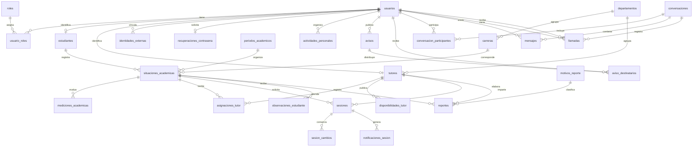

# SITUA — Sistema de tutorías

Aplicación web para gestionar tutorías académicas entre estudiantes, tutores y coordinación. Centraliza la asignación de tutores, disponibilidad, solicitudes de sesiones, seguimiento académico, reportes, avisos y mensajes.

**Aplicación:** [situa.oaxacoders.tech](https://situa.oaxacoders.tech/)

**API:** `https://situa.oaxacoders.tech/api`

**Repositorio:** [github.com/azalorenzo/SITUA](https://github.com/azalorenzo/SITUA)

## Equipo

**Número de equipo:** Por completar.

| Integrante | Nombre completo |
| --- | --- |
| Integrante 1 | Por completar |
| Integrante 2 | Por completar |

## Diseño y organización

| Recurso | Enlace |
| --- | --- |
| Prototipo navegable en Figma | Por completar |
| Tablero público de GitHub Projects | Por completar |

## Funcionalidades

| Rol | Funciones |
| --- | --- |
| Coordinación | Resumen general, administración de usuarios, roles, tutores, catálogos, asignaciones y avisos; gestión del expediente académico, tutorías y reportes, con exportación PDF. |
| Tutor | Consulta de tutorados y expedientes, disponibilidad, confirmación o rechazo de solicitudes, registro de tutorías, seguimiento, reportes, avisos y mensajes. |
| Estudiante | Registro, perfil académico y datos de contacto, elección de tutor, agenda, solicitudes de tutoría, actividades personales, avisos y mensajes con su tutor. |

El acceso utiliza JWT y permisos por rol. Los listados paginados y filtros se resuelven en el backend. Las lecturas de avisos y mensajes se guardan por usuario.

El menú de usuario incluye Perfil para editar los datos personales. Los estudiantes pueden actualizar matrícula, carrera y semestre del periodo vigente y sus preferencias de contacto; los tutores pueden cambiar su departamento. El correo puede cambiarse si la cuenta no está vinculada con Google. La vinculación se comprueba en la base de datos y también se protege desde la API. El rol no se modifica desde esta opción.


### Administración de coordinación

Usuarios permite crear y editar cuentas de los tres roles, asignar matrícula o departamento y activar o desactivar el acceso. Los cambios de permisos, correo, contraseña o estado invalidan las sesiones anteriores. No se puede retirar el acceso propio a coordinación ni dejar el sistema sin una cuenta de coordinación activa. Una cuenta con asignaciones o sesiones pendientes debe resolverlas antes de cambiar de rol.

Catálogos administra carreras, departamentos, periodos académicos y motivos de reporte. Las bajas desactivan los registros o cierran el periodo, conservando el historial. Un periodo con sesiones pendientes no puede cerrarse.

Tutorías permite consultar sesiones de todos los tutores y estudiantes, programar y registrar tutorías, editar horarios futuros, confirmar o rechazar solicitudes, cancelar sesiones y registrar su resultado. Cada cambio registra al usuario de coordinación que lo realizó y respeta las validaciones de asignación y cruces de horario.

Estudiantes permite editar la matrícula y los datos académicos por periodo: carrera, semestre de 1 a 12, inscripción, promedio, riesgo y observaciones. Los cambios de evaluación conservan las mediciones anteriores. Una baja o egreso requiere resolver las sesiones pendientes y finaliza las asignaciones de ese periodo.

Reportes permite crear, consultar, editar, completar, reabrir y eliminar reportes desde coordinación. La eliminación requiere confirmación; las exportaciones PDF continúan disponibles. Los participantes de un reporte existente se conservan.

Las tres vistas usan paginación, búsqueda y filtros del servidor, bajo `/api/coordinacion/administracion`. No requieren nuevas migraciones.

## Tecnologías

| Área | Tecnologías |
| --- | --- |
| Frontend | React 18, TypeScript, Vite 6 y Tailwind CSS 4. |
| Backend | Java 25, Spring Boot 4.1.2, Spring Security, Bean Validation y JPA/JDBC. |
| Base de datos | MySQL y migraciones Flyway. |
| Autenticación | JWT, BCrypt y Google Identity Services. |
| Correo | JavaMailSender con Brevo SMTP y STARTTLS. |
| Reportes | Apache PDFBox. |
| Pruebas de API | Bruno, formato OpenCollection YAML. |
| Despliegue | VPS Debian, Nginx, systemd y HTTPS con Let's Encrypt. |

## Estructura del proyecto

```text
backend/       API Spring Boot, configuración y migraciones
frontend/      Aplicación React
bruno/         Colección de pruebas de la API publicada
database/      Datos de prueba, respaldos y herramientas de base de datos
```

## Instalación local

### Requisitos

- Java JDK 25.
- Node.js 22 o superior y npm.
- MySQL; el despliegue utiliza MySQL Community Server 8.4.13.
- Acceso a internet para descargar las dependencias del Maven Wrapper y npm.

### Base de datos

Crear una base vacía en MySQL:

```sql
CREATE DATABASE tutoria
  CHARACTER SET utf8mb4
  COLLATE utf8mb4_0900_ai_ci;
```

No es necesario crear las tablas manualmente. Flyway aplica las migraciones al iniciar el backend. Las migraciones están en [backend/src/main/resources/base_datos/migraciones](backend/src/main/resources/base_datos/migraciones).

### Backend

Desde la raíz del proyecto, en PowerShell:

```powershell
Copy-Item backend/.env.example backend/.env
```

Completar en `backend/.env`:

```dotenv
BD_SERVIDOR=127.0.0.1
BD_PUERTO=3306
BD_NOMBRE=tutoria
BD_USUARIO=tu_usuario_mysql
BD_CONTRASENA=tu_contrasena_mysql
JWT_CLAVE=tu_clave_aleatoria_en_base64
JWT_MINUTOS_VIGENCIA=15
ORIGENES_PERMITIDOS=http://localhost:5173,http://127.0.0.1:5173
```

Generar una clave JWT de al menos 32 bytes:

```powershell
node -e "console.log(require('node:crypto').randomBytes(32).toString('base64'))"
```

Copiar el resultado en `JWT_CLAVE`. Después iniciar el backend:

```powershell
cd backend
.\mvnw.cmd spring-boot:run
```

En Linux, utilizar `./mvnw spring-boot:run`. La API local escucha en `http://localhost:8080/api`.

### Datos de prueba

Después del primer arranque del backend, ejecutar [database/seeds/001_datos_demo.sql](database/seeds/001_datos_demo.sql) sobre la base `tutoria`, por ejemplo desde MySQL Workbench.

También se puede ejecutar desde el cliente de MySQL, abierto en la raíz del proyecto:

```sh
mysql -h 127.0.0.1 -P 3306 -u tu_usuario_mysql -p tutoria
```

Dentro del cliente:

```sql
SOURCE database/seeds/001_datos_demo.sql;
```

El seed incluye las cuentas de evaluación y los registros de demostración. No se carga automáticamente al iniciar Spring Boot y puede repetirse sin duplicar sus ejemplos.

### Frontend

En otra terminal, desde la raíz:

```powershell
cd frontend
npm ci
Copy-Item .env.example .env
npm run dev
```

Abrir `http://localhost:5173`. Con `VITE_URL_API=/api`, Vite redirige las peticiones al backend local.

Si un archivo `.env` ya está configurado, conservarlo en lugar de reemplazarlo por el ejemplo.

## Credenciales de evaluación

| Rol | Correo | Contraseña |
| --- | --- | --- |
| Coordinación | `coordinacion@demo.example` | `CoordDemo!2026` |
| Tutor | `tutor@demo.example` | `TutorDemo!2026` |
| Estudiante | `estudiante@demo.example` | `AlumnoDemo!2026` |

Coordinación es el perfil de administración disponible en la aplicación. Estas cuentas corresponden a los datos de demostración.

## Base de datos y diagrama ER

Las migraciones V1 a V9 definen el esquema. Hibernate tiene `ddl-auto=none`; la estructura se administra con Flyway. No modificar una migración aplicada: los cambios deben agregarse en una nueva versión.

El siguiente diagrama resume las relaciones principales del sistema, incluidas las de recuperación y notificaciones:



Las relaciones N:M incluyen usuarios–roles mediante `usuario_roles`, avisos–usuarios mediante `aviso_destinatarios` y conversaciones–usuarios mediante `conversacion_participantes`.

El [respaldo SQL de estructura V9](database/respaldo_estructura_v9.sql) corresponde al esquema actual exportado de MySQL en la VPS. Incluye tablas y vistas, sin registros, datos personales ni credenciales. Para una instalación nueva, utilizar las migraciones y el seed; no importar previamente este respaldo sobre la misma base que administrará Flyway. Los respaldos V2 y V3 se conservan como referencias históricas.

## Configuración de integraciones

### Llamadas y videollamadas con Daily

Configurar únicamente en `backend/.env`:

```dotenv
DAILY_CLAVE_API=tu_clave_privada
LLAMADAS_HABILITADAS=true
LLAMADAS_DURACION_MINUTOS=5
```

Reiniciar el backend después de cambiar estas variables. Cada entorno necesita su propia configuración. La clave no se copia al frontend.

Los botones de Mensajes permiten llamar entre estudiante y tutor con una asignación activa. La invitación aparece en cualquier sección de sus perfiles y vence después de 45 segundos sin respuesta. La sala privada se crea cuando el receptor acepta; admite dos personas y finaliza a los cinco minutos. Para llamadas de voz, los permisos de Daily impiden publicar video. No se habilitan grabaciones ni transcripciones.

El navegador necesita permiso para micrófono y, en videollamadas, cámara. Fuera de localhost se requiere HTTPS. El límite de duración se controla en el servidor y en Daily; el consumo depende del plan contratado con el proveedor.

### Recuperación de contraseña por correo

El usuario solicita un código para un correo registrado. El código tiene seis dígitos, vence en diez minutos, permite hasta cinco intentos y solo se puede utilizar una vez. Al cambiar la contraseña se invalidan las sesiones anteriores de la cuenta.

En producción se utiliza Brevo por el puerto 587 con autenticación y STARTTLS. El ejemplo sin credenciales está en [backend/.env.brevo.example](backend/.env.brevo.example):

```dotenv
CORREO_HABILITADO=true
CORREO_SERVIDOR=smtp-relay.brevo.com
CORREO_PUERTO=587
CORREO_USUARIO=tu_login_smtp
CORREO_CONTRASENA=tu_clave_smtp
CORREO_REMITENTE=tu_remitente_verificado
CORREO_SSL=false
CORREO_AUTENTICACION=true
CORREO_STARTTLS=true
```

El login y la clave SMTP se obtienen en Brevo; no son la contraseña de la cuenta ni una API key. El dominio y remitente deben estar autorizados en el proveedor. Las credenciales reales se guardan fuera de Git.

El VPS también tiene Postfix y OpenDKIM. La entrega directa con Postfix depende de la habilitación SMTP de AWS; el envío activo de SITUA utiliza Brevo.

### Acceso con Google

Configurar el mismo ID público de cliente OAuth web en `GOOGLE_CLIENTE_ID` del backend y `VITE_GOOGLE_CLIENTE_ID` del frontend. Autorizar en Google Cloud los orígenes locales y `https://situa.oaxacoders.tech`, según el entorno. Reiniciar el backend y recompilar el frontend después de cambiar estas variables.

### SMS

Los estudiantes pueden registrar su teléfono internacional y autorizar cada canal desde Datos de contacto. El backend dispone de una cola de avisos asociada a la confirmación de tutorías y de una integración con Twilio.

La configuración está en [backend/.env.example](backend/.env.example). Para usar la plantilla precargada Event Notifications en una cuenta de prueba:

```dotenv
SMS_HABILITADO=true
SMS_PLANTILLA_PRUEBA=sms_event_notifications
```

Completar también `TWILIO_CUENTA`, `TWILIO_CLAVE` y `TWILIO_REMITENTE_SMS`. Este modo envía el texto de prueba de Twilio, sin los datos personalizados de la tutoría. Los destinatarios deben estar autorizados por la cuenta de prueba y el envío está sujeto a sus restricciones. La aceptación de la petición no acredita que el SMS haya llegado al teléfono.

Para una cuenta que permita texto personalizado, dejar `SMS_PLANTILLA_PRUEBA` vacío. La clave SMTP de Brevo no sirve para estas integraciones.

## API REST

URL base: `https://situa.oaxacoders.tech/api`.

Las peticiones protegidas deben incluir:

```http
Authorization: Bearer <token>
```

| Método | Ruta relativa | Función |
| --- | --- | --- |
| POST | `/autenticacion/registrar` | Registrar una cuenta de estudiante. |
| POST | `/autenticacion/iniciar-sesion` | Obtener un JWT. |
| GET | `/autenticacion/sesion` | Consultar la cuenta autenticada. |
| POST | `/autenticacion/cerrar-sesion` | Invalidar el JWT actual. |
| POST | `/autenticacion/google` | Ingresar mediante Google. |
| POST | `/autenticacion/recuperacion/solicitar` | Solicitar un código por correo. |
| POST | `/autenticacion/recuperacion/cambiar-contrasena` | Cambiar la contraseña con el código. |
| GET | `/perfil` | Consultar el perfil propio y las opciones de edición. |
| PUT | `/perfil` | Guardar los campos permitidos del perfil propio. |

Los módulos se agrupan bajo `/coordinacion`, `/tutor` y `/estudiante`. La colección Bruno contiene los cuerpos, parámetros, permisos y resultados esperados de los recorridos de prueba.

## Pruebas

### Bruno

Abrir la carpeta [bruno](bruno) desde la opción Abrir colección de Bruno. Utiliza el formato OpenCollection YAML y apunta a la API publicada. Ejecutar las solicitudes en su orden numérico: los primeros logins obtienen los JWT y preparan las variables de los pasos posteriores. Los tokens se guardan solo durante la ejecución.

Desde la carpeta `bruno` también se puede ejecutar:

```sh
npx --yes --package @usebruno/cli@4.3.0 bru run
```

La colección contiene **79 solicitudes y 119 comprobaciones**: acceso de los tres roles, registro, permisos, errores previstos, paginación, filtros, PDF, operaciones sobre horarios, recordatorios y avisos, y rechazo del JWT después de cerrar sesión.

Las pruebas crean datos identificados como Bruno. El recorrido elimina el horario y el recordatorio y retira el aviso. La cuenta registrada y el aviso retirado requieren limpieza administrativa si no se desean conservar: no existen endpoints de borrado para esos registros. La colección no envía correos, SMS, ni modifica contraseñas existentes.

### Backend

Desde `backend`:

```powershell
.\mvnw.cmd test
```

Las pruebas de integración requieren la conexión MySQL configurada y crean registros temporales. Ejecutarlas en una base de pruebas, separada de producción.

### Compilación del frontend

Desde `frontend`:

```sh
npm run build
```

El resultado se genera en `frontend/dist`.

## Despliegue

El frontend se sirve como archivos estáticos y el backend se ejecuta como JAR mediante systemd. Nginx publica ambos bajo el mismo dominio y redirige HTTP a HTTPS.

| Componente | Ruta o servicio del VPS |
| --- | --- |
| Backend | `/opt/situa/actual/aplicacion.jar` |
| Frontend | `/opt/situa/actual/frontend` |
| Servicio de la API | `situa-backend.service`, en `127.0.0.1:8095` |
| MySQL de SITUA | `situa-mysql.service`, en `127.0.0.1:3307` |
| Configuración privada | `/etc/situa/.env` |
| Nginx | `/etc/nginx/sites-available/situa.oaxacoders.tech` |
| Renovación HTTPS | `situa-certificado.timer` |

Los servicios y la base de SITUA son independientes de los demás proyectos del servidor. Las configuraciones de referencia están en [backend/despliegue](backend/despliegue) y [backend/.env.vps.example](backend/.env.vps.example).

Para generar el JAR, desde `backend`:

```powershell
.\mvnw.cmd clean package
```

El archivo se genera en `backend/target/backend-0.0.1-SNAPSHOT.jar`.

Comandos de operación en el VPS:

```sh
sudo systemctl status situa-backend situa-mysql --no-pager
sudo journalctl -u situa-backend -n 80 --no-pager
sudo systemctl restart situa-backend
sudo nginx -t
sudo systemctl reload nginx
```

## Seguridad

- Contraseñas protegidas con BCrypt y validación en frontend y backend.
- JWT con vencimiento, control de roles e invalidación al cerrar sesión.
- Acceso a datos personales limitado al usuario o rol autorizado.
- Validación de entradas y errores JSON con estados HTTP adecuados.
- Variables privadas fuera del repositorio; los archivos `.env` reales no se versionan.
- HTTPS en producción y servicios internos limitados a la interfaz local del VPS.
- Las variables `VITE_` son públicas: no deben contener claves privadas.

## Estado de la entrega

| Componente | Estado |
| --- | --- |
| Aplicación y API en VPS con HTTPS | Disponible. |
| Flujos de coordinación, tutor y estudiante | Integrados con la API y MySQL. |
| Recuperación por correo con Brevo | Operativa; recepción en bandeja comprobada. |
| Acceso con Google | Integrado; requiere configuración OAuth válida para el entorno. |
| SMS | SMS con plantilla de prueba Event Notifications; entrega pendiente de comprobación. |
| Figma, GitHub Projects y datos del equipo | Apartados preparados para completar. |

El correo activo mediante Brevo utiliza un proveedor externo. Si la evaluación exige entrega directa con Postfix, debe validarse esa diferencia con el docente.
