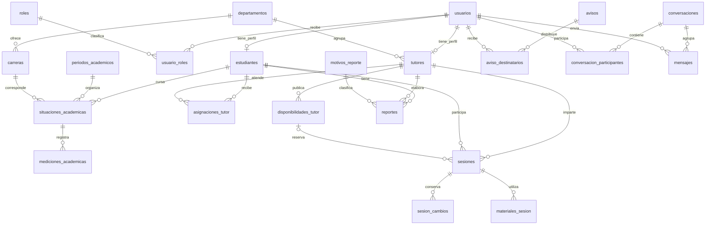

# Análisis de pantallas y diseño lógico de la base de datos

Fecha de revisión: 11 de noviembre de 2026.

Este documento describe los datos necesarios para conectar el mockup a un servidor. Se basa en los componentes de `src/app`, sus formularios, tablas, detalles, filtros y datos de ejemplo. No modifica las pantallas ni implementa un backend.

El diseño es relacional e independiente del motor. Los tipos son orientativos; el DDL, las migraciones y las restricciones específicas se preparan al definir el motor y su versión. Las reglas institucionales que no pueden deducirse de la interfaz se identifican como supuestos pendientes de validación.

## 1. Pantallas existentes y alcance real

| Perfil / pantalla | Componentes revisados | Datos que necesita | Operaciones del servidor previstas |
|---|---|---|---|
| Acceso | `Login`, `App` | Correo, contraseña de entrada, identidad, roles, estado de cuenta | Autenticar, obtener perfil, cerrar sesión. La selección de rol actual es solo demostrativa |
| Coordinación / Inicio | `App`, `StatCard`, `RiskChart`, `TutorshipChart` | Total de estudiantes, tutores activos, estudiantes en riesgo, distribución por motivo, sesiones por mes | Consultas agregadas por periodo; no necesita una tabla de dashboard |
| Coordinación / Tutores | `TutorsManagementView` | Nombre, correo, departamento, contraseña inicial, identificador y estado del tutor | Alta de usuario y perfil en una transacción; edición; desactivación preservando historial |
| Coordinación / Reportes | `ReportsView`, `ReportGenerator`, `ReportStats`, `ReportDetailsTable`, `AcademicReasonsChart` | Estudiante, tutor, fecha, estado, motivo; búsqueda por nombre; totales y distribución | Listar con filtros y paginación; generar/exportar un documento desde un reporte existente |
| Coordinación / Avisos | `CoordinatorNotificationsView` | Título, descripción, prioridad, fecha, destinatarios y lectura individual | Publicar, listar, consultar detalle, marcar leído y retirar aviso |
| Tutor / Inicio | `TutorView` | Tutorados, carrera, riesgo, próximas sesiones, estado, sesiones completadas, pendientes y calendario | Resumen limitado al tutor autenticado |
| Tutor / Mis tutorados | `MyStudentsView` | Nombre, carrera, semestre, promedio, riesgo, condición académica, correo, teléfono, periodo, historial, duración, observaciones y última sesión | Listar asignados, filtrar por riesgo, consultar expediente y registrar sesión para el estudiante seleccionado |
| Tutor / Horarios | `ScheduleView` | Fecha, inicio, fin, ubicación, disponibilidad y alumno cuando hay reserva | Crear/editar/bloquear disponibilidad; consultar ocupación a partir de sesiones |
| Tutor / Sesiones realizadas | `CompletedSessionsView` | Alumno, tema, fecha, hora, estado, observaciones, duración, lugar y materiales | Consultar historial, filtrar, registrar sesión realizada y consultar detalle |
| Tutor / Reportes | `TutorReportsView` | Reportes individuales, promedio por mes y evolución por estudiante | Consultar reportes propios, generar documentos y agregar históricos académicos |
| Tutor / Mensajes | `MessagesView` | Contacto, avatar, conversación, texto, emisor, fecha/hora, último mensaje, no leídos y presencia | Listar conversaciones, enviar mensajes, consultar historial y registrar lectura |
| Tutor / Avisos | `TutorNotificationsView` | Título, texto, prioridad, fecha/hora, lectura y sesión vinculada | Leer uno/todos; aceptar o rechazar una solicitud de sesión identificada por ID |
| Estudiante / Inicio | `StudentView` | Próxima sesión, tema, fecha, lugar, estado, sesiones virtuales, talleres y acciones personales | Consultar próxima sesión y administrar actividades personales |
| Estudiante / Mi agenda | `StudentAgendaView` | Tema, fecha completa, hora, tutor, lugar y estado de sesión | Solicitar, reprogramar y cancelar sesiones; consultar agenda por intervalo |
| Estudiante / Mis tutorías | `StudentTutoriasView` | Tutor, materia/tema, fecha, hora, estado y actividad reciente | Consultar sus propias sesiones y cambios recientes |
| Estudiante / Mensajes | `StudentMessagesView` | Contacto, rol visible, avatar y los mismos datos del chat del tutor | Usar las mismas entidades y operaciones de mensajería |
| Estudiante / Avisos | `StudentNotificationsView` | Título, descripción, categoría, prioridad, fecha/hora y lectura | Consultar destinatarios y registrar lectura por usuario |

Componentes presentes, pero no accesibles mediante la navegación actual:

| Componente | Necesidad de datos | Tratamiento propuesto |
|---|---|---|
| `StudentsManagementView` | Matrícula, nombre, carrera; gráficos de semestre, promedio y riesgo | Cubierto por estudiantes e historial académico. Está importado en `App`, pero no se renderiza |
| `AssignmentsView` | Estudiante, tutor, fecha de asignación, estado, sesiones, última sesión y motivos de pendientes | Incluir asignaciones históricas en el núcleo: también son necesarias para Mis tutorados. El componente está importado, pero no se renderiza |
| `Students` | Matrícula, nombre/apellido, carrera, semestre, correo y evento con título/descripción/fecha | Cubierto por perfiles, historial y actividades; no aparece en los contenedores principales |
| `Sessions` | Alumno, fecha, tema, notas y estado | Cubierto por sesiones; no crear una segunda tabla para esta variante de pantalla |
| `TutorCard`, `BookingModal` | Materia, experiencia, tarifa, reseñas, disponibilidad y mensaje de reserva | Componentes sin uso actual. Fecha, tutor y mensaje caben en sesiones; tarifas, pagos y reseñas quedan fuera del núcleo institucional |

## 2. Convenciones del modelo

- `PK`: clave primaria. `FK`: clave foránea. `UQ`: unicidad. `?`: admite NULL. El resto de campos es obligatorio, salvo indicación explícita.
- Identificadores: `BIGINT`. Usar el mismo tipo para cada PK y sus FK. Si se eligen UUID, cambiar ambos lados de forma consistente.
- Textos breves: `VARCHAR(n)`; contenido libre: `TEXT`; conteos: `SMALLINT` o `INTEGER`; banderas: `BOOLEAN`.
- Fechas civiles: `DATE`. Instantes: `TIMESTAMP` normalizados a UTC; la API convierte a la zona institucional `America/Mexico_City`. El motor determina el tipo físico exacto.
- Todas las tablas de entidad incluyen `creado_en TIMESTAMP` y `actualizado_en TIMESTAMP`. Las tablas de relación simple usan sus fechas específicas.
- Estados y prioridades son códigos estables en minúsculas con validación de dominio. Las etiquetas, colores e iconos pertenecen al frontend.
- El nombre completo se guarda en `usuarios.nombre`; no se intenta separar apellidos a partir de espacios. La matrícula y el teléfono son texto, no números.

## 3. Diccionario propuesto

### Identidad y organización

| Tabla | Campos y tipos | Restricciones / finalidad |
|---|---|---|
| `usuarios` | `id PK`, `nombre VARCHAR(160)`, `correo VARCHAR(254)`, `password_hash VARCHAR(255)`, `telefono VARCHAR(30)?`, `avatar_url VARCHAR(1024)?`, `estado VARCHAR(20)` | Correo normalizado UQ; estado `activo/inactivo`. Se almacena el hash, nunca la contraseña original |
| `roles` | `id PK`, `codigo VARCHAR(30)`, `nombre VARCHAR(60)` | Código UQ: `coordinador`, `tutor`, `estudiante` |
| `usuario_roles` | `usuario_id FK usuarios`, `rol_id FK roles` | PK compuesta; permite que una cuenta tenga más de un rol si posteriormente se requiere |
| `departamentos` | `id PK`, `nombre VARCHAR(120)`, `activo BOOLEAN` | Nombre UQ; evita variaciones del departamento capturadas como texto libre |
| `carreras` | `id PK`, `departamento_id FK departamentos`, `clave VARCHAR(30)`, `nombre VARCHAR(150)`, `activa BOOLEAN` | Clave UQ |
| `tutores` | `id PK`, `usuario_id FK usuarios`, `departamento_id FK departamentos` | Usuario UQ; el rol tutor debe existir en `usuario_roles`. Nombre/correo vienen de usuarios |
| `estudiantes` | `id PK`, `usuario_id FK usuarios`, `matricula VARCHAR(30)` | Usuario UQ y matrícula UQ; el rol estudiante debe existir en `usuario_roles` |
| `periodos_academicos` | `id PK`, `clave VARCHAR(30)`, `nombre VARCHAR(80)`, `fecha_inicio DATE`, `fecha_fin DATE`, `estado VARCHAR(20)` | Clave UQ; inicio <= fin; estados `planeado/activo/cerrado`. No deducir el periodo del mes del navegador |

El perfil de coordinación se representa mediante el rol; la interfaz no exige una tabla propia. Si existen coordinaciones limitadas por carrera o departamento, será necesaria una relación de ámbito explícita antes de implementar permisos.

### Trayectoria académica y seguimiento

| Tabla | Campos y tipos | Restricciones / finalidad |
|---|---|---|
| `situaciones_academicas` | `id PK`, `estudiante_id FK estudiantes`, `periodo_id FK periodos_academicos`, `carrera_id FK carreras`, `semestre SMALLINT`, `estado_inscripcion VARCHAR(20)` | UQ(estudiante, periodo); semestre > 0; inscripción `activo/baja/egresado`. Guarda carrera y semestre del periodo sin perder el pasado |
| `mediciones_academicas` | `id PK`, `situacion_id FK situaciones_academicas`, `medido_en TIMESTAMP`, `promedio DECIMAL(4,2)?`, `nivel_riesgo VARCHAR(10)?`, `condicion TEXT?`, `materias_reprobadas SMALLINT?`, `materias_repeticion SMALLINT?`, `materias_especial SMALLINT?`, `registrado_por FK usuarios` | Conteos >= 0. Riesgo `sin_riesgo/bajo/medio/alto`. Promedio 0..10 como supuesto por validar; NULL significa no registrado. Conserva varias mediciones para las gráficas mensuales |
| `asignaciones_tutor` | `id PK`, `estudiante_id FK estudiantes`, `tutor_id FK tutores`, `periodo_id FK periodos_academicos`, `asignado_por FK usuarios`, `inicio_en TIMESTAMP`, `fin_en TIMESTAMP?`, `estado VARCHAR(20)`, `motivo TEXT?` | Estados `pendiente/activa/finalizada/cancelada`; fin >= inicio. Mantiene cambios de tutor sin sobrescribir el historial |
| `observaciones_estudiante` | `id PK`, `situacion_id FK situaciones_academicas`, `autor_id FK usuarios`, `sesion_id FK sesiones?`, `tipo VARCHAR(20)`, `prioridad VARCHAR(10)`, `contenido TEXT`, `observado_en TIMESTAMP` | Tipo `nota/progreso/alerta`; prioridad `normal/alta`. Separa notas de seguimiento de datos generales del usuario |

Las reglas para calcular riesgo no están definidas por las pantallas. Inicialmente se registra la clasificación y su autor; si se automatiza, agregar versión de regla y conservar el resultado histórico. Los motivos de reportes no sustituyen la clasificación de riesgo.

### Disponibilidad, tutorías y agenda

| Tabla | Campos y tipos | Restricciones / finalidad |
|---|---|---|
| `disponibilidades_tutor` | `id PK`, `tutor_id FK tutores`, `inicio_en TIMESTAMP`, `fin_en TIMESTAMP`, `modalidad VARCHAR(20)`, `ubicacion VARCHAR(200)?`, `enlace_virtual VARCHAR(1024)?`, `estado VARCHAR(20)` | Inicio < fin; modalidad `presencial/virtual`; estado `habilitada/bloqueada`. Una fila representa un intervalo reservable completo en la primera versión |
| `sesiones` | `id PK`, `tutor_id FK tutores`, `estudiante_id FK estudiantes`, `periodo_id FK periodos_academicos`, `disponibilidad_id FK disponibilidades_tutor?`, `tema VARCHAR(200)`, `inicio_en TIMESTAMP`, `fin_en TIMESTAMP`, `modalidad VARCHAR(20)`, `ubicacion VARCHAR(200)?`, `enlace_virtual VARCHAR(1024)?`, `estado VARCHAR(20)`, `mensaje_solicitud TEXT?`, `observaciones TEXT?`, `inicio_real_en TIMESTAMP?`, `fin_real_en TIMESTAMP?`, `creado_por FK usuarios` | Inicio < fin; estados definidos en sección 5. Sesión individual: un tutor y un estudiante. Disponibilidad opcional para permitir registros de sesiones ya realizadas |
| `sesion_cambios` | `id PK`, `sesion_id FK sesiones`, `actor_id FK usuarios`, `tipo VARCHAR(30)`, `estado_anterior VARCHAR(20)?`, `estado_nuevo VARCHAR(20)`, `inicio_anterior TIMESTAMP?`, `fin_anterior TIMESTAMP?`, `inicio_nuevo TIMESTAMP`, `fin_nuevo TIMESTAMP`, `motivo TEXT?`, `ocurrido_en TIMESTAMP` | Historial inmutable de solicitud, aceptación, rechazo, reprogramación, cancelación y cierre. Fuente de actividad reciente |
| `materiales_sesion` | `id PK`, `sesion_id FK sesiones`, `nombre VARCHAR(200)`, `archivo_url VARCHAR(1024)?`, `agregado_por FK usuarios` | La pantalla solo requiere nombre; archivo/enlace es opcional. Una fila por material, sin concatenar una lista en una columna |
| `actividades_personales` | `id PK`, `propietario_id FK usuarios`, `titulo VARCHAR(200)`, `descripcion TEXT?`, `tipo VARCHAR(20)`, `fecha DATE?`, `inicio_en TIMESTAMP?`, `fin_en TIMESTAMP?`, `tutor_id FK tutores?`, `responsable_texto VARCHAR(160)?`, `ubicacion VARCHAR(200)?`, `estado VARCHAR(20)` | Tipo `taller/recordatorio`; estado `pendiente/completada/cancelada`. Permite una acción sin fecha y un taller personal fechado. Si hay inicio, requiere fin > inicio; fecha civil y intervalo son alternativas excluyentes |

Las sesiones virtuales son filas de `sesiones` con modalidad virtual, no una tabla duplicada. Los talleres de esta propuesta representan los elementos personales del mockup; inscripciones grupales, cupos y asistencia a talleres institucionales requerirían entidades adicionales. `responsable_texto` sirve solo cuando el facilitador no es un tutor registrado; no se llena simultáneamente con `tutor_id`.

La duración programada se calcula con inicio/fin; la real con inicio_real/fin_real. La API devuelve minutos y la pantalla decide si muestra “1 hora” o “1.5 horas”. La sesión conserva su ubicación pactada aunque después cambie la disponibilidad.

### Reportes y avisos

| Tabla | Campos y tipos | Restricciones / finalidad |
|---|---|---|
| `motivos_reporte` | `id PK`, `codigo VARCHAR(40)`, `nombre VARCHAR(120)`, `activo BOOLEAN` | Código UQ. Semillas observadas: bajo rendimiento, ansiedad/estrés, problemas familiares y otros; validar el catálogo con coordinación |
| `reportes` | `id PK`, `estudiante_id FK estudiantes`, `tutor_id FK tutores`, `periodo_id FK periodos_academicos`, `sesion_id FK sesiones?`, `motivo_id FK motivos_reporte`, `fecha DATE`, `contenido TEXT?`, `estado VARCHAR(20)`, `completado_en TIMESTAMP?`, `completado_por FK usuarios?` | Estado `pendiente/completado`; fecha es la del reporte, distinta de creación. Un motivo principal por reporte, como actualmente muestran las filas y gráficas |
| `avisos` | `id PK`, `autor_id FK usuarios`, `titulo VARCHAR(200)`, `descripcion TEXT`, `categoria VARCHAR(40)`, `prioridad VARCHAR(10)`, `sesion_id FK sesiones?`, `publicado_en TIMESTAMP`, `retirado_en TIMESTAMP?` | Prioridad `normal/media/alta`. Sesión FK para solicitudes y recordatorios; el código no debe decidir acciones comparando el título del aviso |
| `aviso_destinatarios` | `aviso_id FK avisos`, `usuario_id FK usuarios`, `leido_en TIMESTAMP?`, `ocultado_en TIMESTAMP?` | PK compuesta. Un mismo aviso puede estar leído por un usuario y pendiente para otro. Destinatarios explícitos se resuelven al publicar |

Exportar un PDF no completa un reporte ni cambia el estado de una tutoría. Si se exige un documento histórico inalterable, agregar posteriormente versiones con archivo, fecha y datos de corte; una exportación dinámica puede reflejar cambios del expediente.

Retirar un aviso para todos (`retirado_en`) y ocultarlo para una persona (`ocultado_en`) son operaciones diferentes. “Leídos” y “pendientes” son métricas del destinatario actual, no del autor de un aviso masivo.

### Mensajería

| Tabla | Campos y tipos | Restricciones / finalidad |
|---|---|---|
| `conversaciones` | `id PK`, `tipo VARCHAR(20)`, `creada_por FK usuarios` | Primera versión: `directa`; el servidor valida exactamente dos participantes al crear |
| `conversacion_participantes` | `conversacion_id FK conversaciones`, `usuario_id FK usuarios`, `unido_en TIMESTAMP`, `leido_hasta_en TIMESTAMP?` | PK compuesta. El servidor avanza lectura con su propia hora y limita la operación al usuario autenticado |
| `mensajes` | `id PK`, `conversacion_id FK conversaciones`, `emisor_id FK usuarios`, `contenido TEXT`, `enviado_en TIMESTAMP` | FK compuesta (conversacion_id, emisor_id) a participantes: el emisor pertenece a la conversación. Texto no vacío |

Último mensaje y conteo de no leídos se consultan sobre mensajes y lectura del participante; no se guardan manualmente en cada pantalla. `isSent` se calcula comparando emisor con el usuario autenticado. La presencia “en línea” necesita actividad reciente/conexiones; no se conserva como un booleano permanente. Adjuntos, llamadas y videollamadas son iconos sin flujo implementado: quedan como ampliaciones, no como requisitos confirmados.

El chat con “Soporte Técnico” es un dato de ejemplo. Su rol y alcance deben definirse si se convierte en una función real; no asumir un cuarto rol por esa etiqueta.

## 4. Relaciones principales

El diagrama resume relaciones centrales; todas las FK, incluidas las opcionales, están en el diccionario. Una disponibilidad admite varias sesiones históricas canceladas/rechazadas, pero solo una reserva vigente bajo el supuesto de intervalo completo.

## 5. Reglas de integridad y flujos

1. **Asignación no es sesión.** La asignación identifica al tutor de seguimiento durante un periodo. Las sesiones registran encuentros concretos, incluso con otro tutor si la institución lo permite. Supuesto inicial: una sola asignación activa por estudiante y periodo; validar si existen cotutores. Evitar intervalos de asignación activa superpuestos.
2. **Sesión:** `solicitada -> confirmada/rechazada/cancelada`; `confirmada -> completada/cancelada/no_asistio`. Registrar una sesión ya realizada puede crear `completada` directamente, con autor e historial. Rechazar conserva el registro; cancelar no equivale a borrarlo.
3. **Reserva:** validar tutor, estudiante, disponibilidad habilitada, modalidad y periodo; una reserva vinculada ocupa el intervalo completo. Solicitar/confirmar debe comprobar solapamientos con sesiones `solicitada` o `confirmada` del tutor y del estudiante dentro de la misma transacción. Una comprobación aislada antes del INSERT no evita reservas simultáneas. Implementar bloqueo o restricción apropiada al motor.
4. **Reprogramación:** verificar el nuevo intervalo, liberar la reserva anterior, actualizar la referencia de disponibilidad si aplica y registrar horas anteriores/nuevas en la misma transacción. No alterar silenciosamente una sesión completada.
5. **Consistencia de FK:** las relaciones redundantes deben coincidir: tutor de disponibilidad = tutor de sesión; estudiante/tutor/periodo del reporte = los de la sesión cuando se vincula; observación vinculada a sesión pertenece al mismo estudiante de la situación académica. Validar mediante claves compuestas o dentro de la transacción del servidor.
6. **Notificación de solicitud:** crear sesión, cambio y aviso con destinatario en una transacción. Aceptar/rechazar cambia la sesión y registra la respuesta; marcar aviso leído solo cambia lectura. Verificar estado vigente para impedir aceptar una sesión ya cancelada.
7. **Cuentas y expedientes:** desactivar cuentas y cerrar asignaciones; restringir borrado de perfiles referenciados por sesiones/reportes. Los registros académicos históricos no se eliminan en cascada al quitar una cuenta.
8. **Mediciones:** usar la última medición disponible del periodo para riesgo actual; la última medición de cada mes para evolución individual. Los promedios grupales deben fijar población y fecha de corte; no mezclar periodos ni promediar duplicados por estudiante.
9. **Permisos:** estudiante consulta su expediente, sesiones, actividades, chats y avisos; tutor consulta los estudiantes asignados y las sesiones que atiende; coordinación gestiona su ámbito institucional. El servidor obtiene identidad desde la autenticación y valida acceso; un ID enviado por el cliente no concede permisos.
10. **Coherencia académica:** estudiante/periodo de asignaciones, sesiones y reportes debe existir en `situaciones_academicas`. Si la institución admite atención a estudiantes no inscritos, documentar la excepción antes de retirar esta regla. Vincular la operación a un periodo explícito, sin inferirlo por una fecha del navegador.

## 6. Datos calculados y consultas necesarias

| Dato visible | Fuente / cálculo |
|---|---|
| Total de estudiantes | Situaciones académicas del periodo y estado de inscripción definido; no confundir con total histórico de cuentas |
| Tutores activos | Perfiles tutor con cuenta activa; definir si además se exige alguna asignación del periodo |
| Estudiantes en riesgo | Última medición de cada estudiante del periodo, según niveles que coordinación decida contar |
| Motivos de atención | Reportes agrupados por motivo; no usar este conteo como si fuera cantidad de alumnos en riesgo |
| Tutorías mensuales | Sesiones completadas agrupadas por mes de realización en zona institucional; separar confirmadas/solicitadas |
| Mis tutorados | Asignaciones activas del tutor en el periodo, unidas con usuario, carrera y última medición |
| Tutorías realizadas / última sesión | COUNT y MAX de sesiones completadas del estudiante/tutor en el periodo |
| Próxima tutoría | Primera sesión confirmada futura del estudiante ordenada por inicio; solicitudes pendientes se muestran aparte |
| Horario ocupado | Sesión vigente vinculada a disponibilidad o intervalo solapado; no un booleano duplicado independiente |
| Total de horas | Suma de duración real de sesiones completadas; si se usa duración programada como sustituto, indicarlo en el indicador |
| Avisos no leídos | Destinatarios del usuario con `leido_en IS NULL`, sin retiro global ni ocultamiento personal |
| Último mensaje / no leídos | Último mensaje por conversación; mensajes de otros emisores posteriores a lectura del participante |
| Actividad reciente | Cambios de sesiones y actividades, ordenados por fecha del servidor |

Las búsquedas y la paginación deben aplicarse en el servidor al conectar las listas. No almacenar tarjetas, colores, textos de fecha (“ayer”, “15 mayo”), índices de página o filtros como columnas de negocio.

## 7. Índices iniciales y validaciones físicas

- Únicos: correo normalizado, matrícula, claves de carrera/periodo/rol/motivo, usuario en cada perfil y estudiante+periodo en situaciones académicas.
- `asignaciones_tutor(tutor_id, periodo_id, estado)` y `(estudiante_id, periodo_id, estado)`; la restricción de una activa depende del motor y no se resuelve con UQ(estudiante, periodo, estado), porque impediría varios registros históricos finalizados.
- `mediciones_academicas(situacion_id, medido_en, id)` para recuperar la última con desempate estable.
- `sesiones(tutor_id, inicio_en, estado)` y `(estudiante_id, inicio_en, estado)`; indexar FK de disponibilidad y periodo. Estos índices ayudan a consultar pero por sí solos no impiden solapamientos.
- `disponibilidades_tutor(tutor_id, inicio_en, fin_en)` y `sesion_cambios(sesion_id, ocurrido_en, id)`.
- `reportes(tutor_id, periodo_id, estado, fecha)` y `(estudiante_id, periodo_id, fecha)`.
- `aviso_destinatarios(usuario_id, leido_en, aviso_id)`; PK evita entregar dos veces el mismo aviso al mismo usuario.
- `conversacion_participantes(usuario_id, conversacion_id)` y `mensajes(conversacion_id, enviado_en, id)` para listas e historial paginado.
- Indexar las demás FK según las consultas. Búsquedas por fragmentos de nombre pueden necesitar índices específicos del motor; un índice convencional no garantiza acelerar búsquedas con comodín inicial.
- Validar todos los dominios de estado, rangos y nulabilidad también en la base de datos cuando el motor lo permita; no depender únicamente del frontend.

## 8. Inconsistencias del mockup que deben resolverse antes de integrar

- El indicador “Estudiantes en riesgo” de `App` toma `pendientes`; esa cantidad no define riesgo académico. Además, `RiskChart` usa motivos. Deben separarse riesgo por estudiante y motivos por reporte.
- `TutorView` presenta “Bajo” con rojo y “Alto” con verde, mientras `MyStudentsView` trata alto como rojo. Unificar el significado y los colores; los datos de ejemplo no definen reglas institucionales.
- Hay fechas escritas como texto y una agenda fija en junio de 2026. La API debe enviar fechas completas, no solo el día ni una frase localizada.
- `ScheduleView` distingue inicio/fin, pero algunos formularios de sesión solo solicitan inicio. Hace falta capturar fin o acordar una duración predeterminada antes de aceptar reservas.
- La pantalla Mis tutorados pide alumno mediante el contexto seleccionado; el futuro registro debe enviar su ID, no solo tema y fecha.
- Los formularios mezclan “Virtual” con ubicación. Separar modalidad, ubicación y enlace de conexión.
- `ReportGenerator` llama “Estatus de tutoría” al filtro de estado del reporte. Son dominios distintos y deben etiquetarse por separado.
- Los destinatarios de avisos no se capturan actualmente. El servidor necesita una audiencia explícita: usuarios, roles o grupos, resuelta a destinatarios individuales.
- Promedio y riesgo aparecen sin formulario de origen. Definir quién los captura o qué sistema académico los proporciona; las gráficas necesitan mediciones reales con fecha.
- “Activo”, “Confirmada”, “Programada” y “Pendiente” aparecen en contextos distintos. Usar estados independientes para cuentas, asignaciones, sesiones y reportes.

## 9. Decisiones pendientes y siguiente entregable

El núcleo propuesto tiene **24 tablas**: 8 de identidad/organización, 4 académicas, 5 de agenda/sesiones, 4 de reportes/avisos y 3 de mensajería. Una misma entidad sirve a varias pantallas.

Antes del DDL final se deben confirmar:

1. Motor y versión del servidor.
2. Si un estudiante puede tener varios tutores de seguimiento simultáneos y si puede reservar con tutores distintos del asignado.
3. Escala de promedio, reglas de riesgo, origen de datos académicos y criterios de los indicadores.
4. Duración mínima/predeterminada, si una disponibilidad se reserva completa o admite subintervalos, y política de reprogramación/no asistencia.
5. Si los talleres son recordatorios personales o eventos institucionales grupales.
6. Audiencia de avisos y alcance institucional de coordinación; en el mockup no se especifican.
7. Si los reportes son expedientes editables o documentos con versiones/aprobaciones. La aprobación aparece únicamente como texto de un chat de ejemplo, no como un flujo confirmado.

Con estas decisiones, el siguiente entregable puede ser el script SQL de creación con FK, CHECK, índices, catálogos iniciales y una migración reproducible. Autenticación persistente, recuperación de cuenta, adjuntos de chat, tarifas y reseñas se diseñan solo si se incorporan a los requisitos; no están implícitos en la navegación actual.
